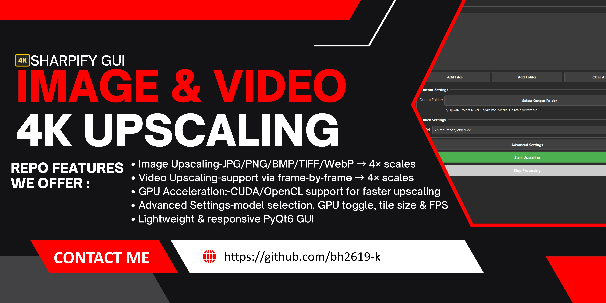
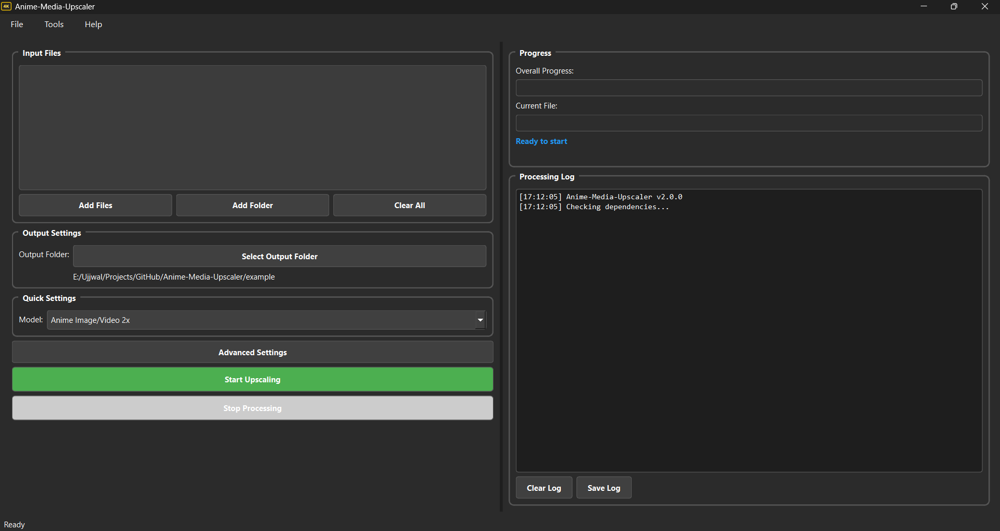

<h1>
  
  sharpify-gui
</h1>

<div align="center">
  
</div>

<div align="center">
  
</div>

---

## 🖼 Screenshot

<div align="center">
  
  <p><em>GUI Interface</em></p>
</div>

---

## 🖼️ Example

<div align="center">
  <h3>Input</h3>
  
  <h3>Output</h3>
  
</div>

---

## ✨ What’s New in v1.0.0

- 🎉 **Initial release** with core download and UI functionality
- ✅ **Video Upscaling** support via frame‑by‑frame Real‑ESRGAN + FFmpeg reassembly
- ✅ **Multi‑threaded** batch processing with real‑time progress bars
- ✅ **Advanced Settings** dialog: model selection, GPU toggle, tile size, FPS & quality
- ✅ **Comprehensive Logging** system with save/load capability
- ✅ **Drag‑and‑Drop** interface enhancements

---

## 🛠️ All Features

- **Image Upscaling**: JPG/PNG/BMP/TIFF/WebP → 4× scales
- **Video Upscaling**: MP4/AVI/MKV/MOV/WMV/FLV → upscaled frames + original audio
- **Batch Queue**: enqueue multiple files for sequential processing
- **Model Manager**: choose from anime‑optimized & general SR Real‑ESRGAN variants
- **GPU Acceleration**: CUDA/OpenCL support for faster upscaling
- **Advanced Settings**: tile size, output format (jpg/png/webp), FPS, CRF quality
- **Auto‑Folder**: outputs organized into timestamped sessions
- **Drag‑and‑Drop**: intuitive file/folder addition
- **Logging**: timestamped logs, clear & save to file

---

## 🕹 Usage

### Prerequisites

- GitHub

### Installation

```bash
# Clone the repository
git clone https://github.com/bh2619-k/sharpify-gui.git
```

For more detailed documentation, see our [USAGE.md](USAGE.md)

---

## 📋 Roadmap

- [x] GPU Acceleration
- [x] Model Manage
- [x] Batch Queue

See the [open issues](https://github.com/bh2619-k/sharpify-gui/issues) for a full list of proposed features and known issues.

---

## 🙏 Acknowledgments

- [Real‑ESRGAN](https://github.com/xinntao/Real-ESRGAN) for super‑resolution models
- [PyQt6](https://pypi.org/project/PyQt6/) for the GUI framework
- [FFmpeg](https://ffmpeg.org/) for high‑quality video processing
